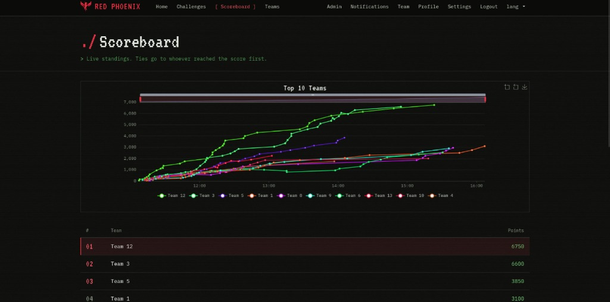

# Red Phoenix CTF 2026 - Writeups (1st Place)

<p align="center">
  
  
  
  
  
  
</p>

---

## Overview

On **October 24, 2026**, our team competed in **Red Phoenix CTF 2026**, organized by the National School of Applied Sciences (ENSA Oujda). We finished in **1st place** with a score of **6,750 points**.

While the event featured **30 challenges** in total, this repository is a curated collection focusing on the **8 most technically interesting, unique, and rewarding challenges** we solved. Rather than documenting trivial tasks, these writeups dive deep into the standout challenges across **Binary Exploitation (Pwn)**, **Reverse Engineering**, **Web Security**, **Cryptography**, **Network Forensics**, and **Steganography**.

Each writeup walks through:
- **Core Concepts & Theory:** Clear explanations of the underlying vulnerabilities with visual diagrams.
- **Step-by-Step Reconnaissance & Triage:** Terminal sessions, disassembly, traffic analysis, and debugging.
- **Methodology & Exploitation:** The exact step-by-step commands, analysis, and techniques used to capture each flag.
- **Remediation & Defense:** Key takeaways on how to mitigate and patch these issues in real-world systems.

---

## Scoreboard

<p align="center">
  
</p>

---

## Featured Challenges (8 Highlights from 30)

| Challenge | Category | Difficulty | Points | Concept / Vulnerability | Flag | Writeup |
|:---|:---|:---:|:---:|:---|:---|:---:|
| **[bytewarden](writeups/bytewarden.md)** | Reverse Engineering | `Hard` | 500 | Custom VM, FNV-1a Hash Seeding, 16-Round Invertible Cipher | `RPCTF{fr0m_h4f47_4l_34rch}` | [View Writeup](writeups/bytewarden.md) |
| **[ret2win baby](writeups/ret2win.md)** | Binary Exploitation | `Medium` | 400 | Unbounded Buffer Overflow, x86-64 16-byte Stack Alignment | `RPCTF{0v3rwr1t3_th3_r3turn}` | [View Writeup](writeups/ret2win.md) |
| **[chno kaybalik](writeups/chno_kaybalik.md)** | Steganography | `Medium` | 350 | Blue Channel Pixel Masking + Rijndael-128 Steghide Password Cracking | `RPCTF{CL4R1TY_B3YOND_v1sual_n0ise}` | [View Writeup](writeups/chno_kaybalik.md) |
| **[operation_failed](writeups/operation_failed.md)** | Cryptography | `Medium` | 350 | Known-Plaintext Slide Attack on Repeating-Key XOR + Base64 + ROT13 | `RPCTF{strike_at_first_light}` | [View Writeup](writeups/operation_failed.md) |
| **[labyrinth](writeups/labyrinth.md)** | Web Exploitation | `Medium` | 300 | HTTP OPTIONS Verb Probing, Header Authentication (`Authorization`) | `RPCTF{v13w_s0urc3_1s_und3rr4t3d}` | [View Writeup](writeups/labyrinth.md) |
| **[ma_b9atch_tswira](writeups/ma_b9atch_tswira.md)** | Digital Forensics | `Easy` | 300 | Corrupted JPEG Start-of-Image (`0xFFD8`) File Signature Repair | `RPCTF{m4g1c_by73s_d0n7_l13}` | [View Writeup](writeups/ma_b9atch_tswira.md) |
| **[capture.pcap](writeups/capture_pcap.md)** | Network Forensics | `Easy` | 250 | Hexadecimal DNS Tunneling & Subdomain Data Exfiltration | `RPCTF{wiresh4rk_3la_9ed_l7al}` | [View Writeup](writeups/capture_pcap.md) |
| **[user_1042](writeups/user_1042.md)** | Web Exploitation | `Easy` | 200 | Insecure Direct Object Reference (IDOR) with MD5-Obfuscated Numeric IDs | `RPCTF{h1dd3n_bu7_n07_s4f3}` | [View Writeup](writeups/user_1042.md) |

---

## Repository Structure

```
RPCTF2026/
├── images/                   # Challenge artifacts and scoreboard proof
└── writeups/                 # In-depth technical writeups
    ├── bytewarden.md         # Reverse Engineering: Custom VM & cipher inversion
    ├── capture_pcap.md       # Network Forensics: DNS tunnel packet analysis
    ├── chno_kaybalik.md      # Steganography: Dual-layer color & steghide extraction
    ├── labyrinth.md          # Web Security: HTTP verb tampering & header bypass
    ├── ma_b9atch_tswira.md   # Digital Forensics: JPEG magic byte restoration
    ├── operation_failed.md   # Cryptography: Known-plaintext cryptanalysis & multi-tier decode
    ├── ret2win.md            # Binary Exploitation: Stack overflow & ABI alignment bypass
    └── user_1042.md          # Web Security: IDOR enumeration & MD5 pre-image prediction
```

---

## Tools Used

| Category | Tools & Libraries |
|:---|:---|
| **Binary Exploitation & Pwn** | `GDB`, `pwntools`, `GEF`, `objdump`, `readelf`, `checksec` |
| **Reverse Engineering** | `Ghidra`, Python Disassembler, `readelf` |
| **Network Forensics** | `Wireshark`, `tshark`, `xxd` |
| **Steganography & Forensics** | `stegseek`, `steghide`, `Pillow` (`PIL`), `exiftool` |
| **Web Exploitation** | `curl`, `Burp Suite`, `Python requests` |
| **Cryptography** | `Python3`, `base64`, `hashlib`, `CyberChef` |

---

<p align="center">
  <i>Written by <b>secbymorchid</b></i>
</p>
