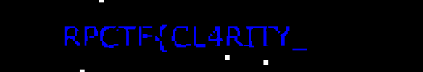

# chno kaybalik

<p align="center">
  
  
  
  
</p>

---

## Executive Summary

`chno kaybalik` (Moroccan Darija for *"What do you see?"*) is a two-stage steganography challenge distributed as a 1200x800 JPEG image named `carrier.jpg`. The author hid two halves of the flag using two entirely different steganographic paradigms:
1. **Spatial Domain:** An imperceptible pixel cluster where the Blue color channel equals `2` (`B == 2`), revealing `RPCTF{CL4R1TY_`.
2. **Frequency/Transform Domain:** An encrypted payload embedded in the image's Discrete Cosine Transform (DCT) coefficients using `steghide`. Cracking the seed and passphrase using `stegseek` with `rockyou.txt` reveals passphrase `phoenixashes` and yields `B3YOND_v1sual_n0ise}`.

---

## Fundamental Concepts for Beginners

### 1. Steganography vs. Cryptography
- **Cryptography:** Scrambles a message so that unauthorized observers cannot read it (the existence of the secret message is obvious).
- **Steganography:** Conceals a message inside ordinary carrier media (like an image or audio file) so that observers don't even know a secret exists.

### 2. Spatial Domain vs. Frequency Domain Steganography

```
                    +-------------------------------------+
                    |       carrier.jpg (1200x800)        |
                    +-------------------------------------+
                                       |
                +----------------------+----------------------+
                |                                             |
                v                                             v
     [ Spatial Domain: Pixels ]                  [ Frequency Domain: DCT ]
                |                                             |
  Pixel Value: RGB(0, 0, 2)                     8x8 DCT Block Coefficients
  Completely pitch black to eye!                Modified by Steghide (Rijndael)
                |                                             |
  Extract via Pillow Binary Mask                Crack via StegSeek + rockyou.txt
                |                                             |
                v                                             v
     "RPCTF{CL4R1TY_"                             "B3YOND_v1sual_n0ise}"
                \                                             /
                 +---------------------+---------------------+
                                       v
                    RPCTF{CL4R1TY_B3YOND_v1sual_n0ise}
```

- **Spatial Domain (Pixels):** Modifies the raw pixel color values directly (Red, Green, Blue from 0 to 255). Because human eyes cannot distinguish between pure black `RGB(0, 0, 0)` and near-black `RGB(0, 0, 2)`, data can be hidden in plain sight.
- **Frequency Domain (DCT in JPEG):** JPEG images are compressed into $8 \times 8$ blocks using Discrete Cosine Transforms. Tools like `steghide` embed encrypted data by modifying the low-frequency DCT coefficients, leaving characteristic $8 \times 8$ visual artifacts across uniform regions.

---

## Step 1: Initial Image Triage

The challenge description provided a clue in Moroccan Darija:
> *"There is something hidden in this picture, and not everything that appears is what is there. Search well, maybe the truth is right in front of your eyes!"*  
> **Hints:** `first part`, `second part`

We inspect the file metadata:
```bash
$ file carrier.jpg
carrier.jpg: JPEG image data, JFIF standard 1.01, baseline, precision 8, 1200x800, components 3

$ exiftool carrier.jpg
# Standard JPEG headers, no comments or hidden EXIF payloads.
```

Opening `carrier.jpg` in an image viewer displays what appears to be a solid black background. Boosting the gamma and contrast exposes a faint, red decoy message in the center:
```text
"you think that's it?"
```
This is a classic CTF decoy intended to trick players into searching strings or metadata.

---

## Step 2: Extracting Part 1 — Blue Channel Isolation

Inspecting pixel value distributions across the three color channels:

```python
from PIL import Image

img = Image.open("images/carrier.jpg")
r, g, b = img.split()

print("Red values:  ", set(r.getdata()))
print("Green values:", set(g.getdata()))
print("Blue values: ", set(b.getdata()))
```

### Analysis:
While the Red channel contains the decoy text and Green is almost entirely zeroes, the **Blue channel** contains a sparse cluster of pixels having a value of exactly **2**:

```
Blue values: {0, 1, 2}
```

Since RGB `(0, 0, 2)` has a luminance difference of less than 0.8% compared to pure black `(0, 0, 0)`, it is completely undetectable on computer screens.

### Generating the High-Contrast Mask:
We iterate over the pixels, setting any pixel with `B == 2` to pure white (`255`) and all other pixels to pure black (`0`):

```python
from PIL import Image

img = Image.open("images/carrier.jpg")
b_channel = img.split()[2]
w, h = b_channel.size

mask = Image.new("L", (w, h), 0)
pixels = b_channel.load()
mask_pixels = mask.load()

for y in range(h):
    for x in range(w):
        if pixels[x, y] == 2:
            mask_pixels[x, y] = 255

# Crop to the region containing the glyphs
cropped = mask.crop((350, 570, 850, 635))
cropped.save("images/carrier_flag_part.png")
```

<p align="center">
  
</p>

### Recovered First Half:
```text
RPCTF{CL4R1TY_
```
The trailing underscore confirms the flag continues into a second part.

---

## Step 3: Extracting Part 2 — Steghide Detection & StegSeek Cracking

### Detecting Steghide Fingerprints
When analyzing the rest of the image, we noticed small $8 \times 8$ grid blocks where pixel values subtly shifted to `(1, 1, 1)`. In JPEG steganography, this grid pattern is the definitive signature of **`steghide`**, which distributes pseudo-randomized bit insertions across DCT coefficient blocks.

`steghide` encrypts its embedded payloads using Rijndael-128 (AES) and requires a passphrase.

### Detecting the Steghide Payload
We run `stegseek` with `--seed` to verify if a valid steghide structure exists:

```bash
$ stegseek --seed images/carrier.jpg
[i] Found (possible) seed: "28f9d374"
    Plain size: 52.0 Byte(s) (compressed)
    Encryption Algorithm: rijndael-128
```
`stegseek` discovered a 52-byte compressed, encrypted payload embedded inside!

### Cracking with Wordlists
Using `stegseek` to crack the passphrase against the standard `rockyou.txt` dictionary:

```bash
$ stegseek images/carrier.jpg /usr/share/wordlists/rockyou.txt secret.txt
StegSeek 0.6 - https://github.com/RickdeJager/StegSeek

[i] Progress: 5.12% (736,892 / 14,344,392 words)
[i] Found passphrase: "phoenixashes"
[i] Original filename: "secret.txt".
[i] Extracting to "secret.txt".
```

Checking the contents of `secret.txt`:
```bash
$ cat secret.txt
B3YOND_v1sual_n0ise}
```

---

## Step 4: Assembling the Flag

Concatenating both discovered segments:
- **Part 1 (Blue Channel Mask):** `RPCTF{CL4R1TY_`
- **Part 2 (Steghide / Passphrase `phoenixashes`):** `B3YOND_v1sual_n0ise}`

**Final Flag:**
```
RPCTF{CL4R1TY_B3YOND_v1sual_n0ise}
```

---


## Defensive Takeaways & SOC Detection

1. **Digital Lossless Inspection:**
   In enterprise environments and data loss prevention (DLP) systems, images uploaded or emailed should be checked for anomalous color histograms. Solid backgrounds with non-uniform low-entropy clusters (`B = 2`) indicate data hiding.
2. **Re-Encoding to Neutralize Stego:**
   Re-compressing or stripping metadata and re-encoding uploaded user avatars (e.g. converting JPEG to WebP or re-quantizing) strips spatial steganography and destroys DCT-embedded payloads without impacting visual fidelity.
