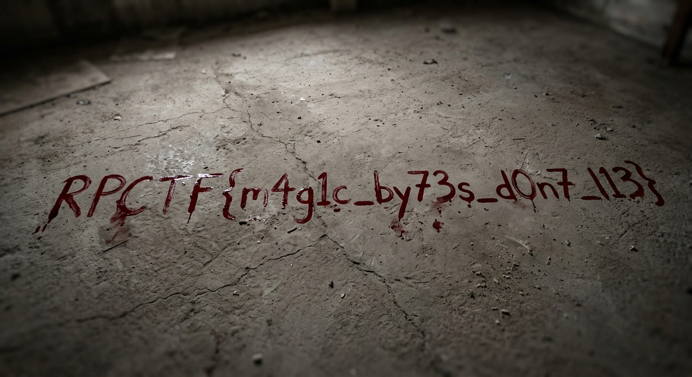

# Ma B9atch Tswira

<p align="center">
  
  
  
  
</p>

---

## Executive Summary

`Ma B9atch Tswira` (Moroccan Darija for *"It is no longer a picture"*) is a digital forensics challenge focusing on file signature analysis. An image file named `img.jpeg` fails to open in standard image viewers, and the Linux `file` utility classifies it as generic `data`. Hexadecimal inspection reveals that the file's first two bytes were wiped with null bytes (`\x00\x00`). Because the subsequent markers immediately follow valid JPEG specification standards (`\xFF\xDB` - Define Quantization Table), restoring the canonical JPEG **Start of Image (SOI)** marker (`\xFF\xD8`) completely repairs the file. Viewing the recovered image displays a crime scene with the flag written on the floor: `RPCTF{m4g1c_by73s_d0n7_l13}`.

---

## Fundamental Concepts for Beginners

### 1. What are Magic Bytes (File Signatures)?
Operating systems, web browsers, and antivirus engines do not rely on file extensions (`.png`, `.jpg`, `.pdf`) to identify files. File extensions can be renamed arbitrarily without altering the underlying binary data.

Instead, file parsers inspect the first few bytes of the file—known as **magic bytes** or **file signatures**:
- When you run the Linux `file` command, it checks the file's leading bytes against the system magic database (`/usr/share/misc/magic.mgc`).
- If the signature bytes are corrupted, image rendering libraries will abort decoding to prevent undefined behavior or buffer overflow vulnerabilities.

### 2. JPEG File Format Specification
Every compliant JPEG stream is delimited by specific two-byte marker codes beginning with `0xFF`:

| Marker | Name | Description |
|:---:|:---|:---|
| **`FF D8`** | **SOI (Start of Image)** | **Mandatory.** The very first two bytes of every JPEG file. |
| `FF DB` | DQT (Define Quantization Table) | Defines DCT quantization matrices. |
| `FF C0` | SOF0 (Start of Frame) | Defines image dimensions (height, width) and color channels. |
| `FF C4` | DHT (Define Huffman Table) | Stores entropy decoding tables. |
| `FF DA` | SOS (Start of Scan) | Begins the compressed entropy-coded image data. |
| **`FF D9`** | **EOI (End of Image)** | **Mandatory.** The terminal two bytes of a JPEG file. |

```
Corrupted File:
Offset 0x00: [ 00 00 ] [ FF DB 00 43 ... ]  <--- Fails! Linux sees raw 'data'
                ^
             Corrupted bytes

Repaired File:
Offset 0x00: [ FF D8 ] [ FF DB 00 43 ... ]  <--- Success! Recognized as JPEG
                ^
             Valid JPEG Start of Image (SOI)
```

---

## Step 1: File Inspection & Triaging

The challenge provides a 786,920-byte file named `img.jpeg`. Attempting to open the file in an image viewer yields an error: *"Invalid image format"*.

Running the `file` command:

```bash
$ file img.jpeg
img.jpeg: data
```

Instead of recognizing it as a JPEG or JFIF image, the system reports generic binary `data`.

---

## Step 2: Hexadecimal Analysis

We inspect the first 16 bytes using Python:

```bash
$ python3 -c "with open('img.jpeg', 'rb') as f: print(f.read(16).hex(' '))"
00 00 ff db 00 43 00 01 01 01 01 01 01 01 01 01
```

### Analysis of the Header:
1. **Offset `0x00 - 0x01`:** `00 00` (Null bytes). In a valid JPEG, this **must** be `FF D8`.
2. **Offset `0x02 - 0x03`:** `FF DB`. This is the standard JPEG marker for **Define Quantization Table (DQT)**!
3. **Offset `0x04 - 0x05`:** `00 43` (67 bytes). Specifies the length of the quantization table.

The author corrupted only the first 2 bytes (`FF D8` $\rightarrow$ `00 00`) to break the parser header check. The rest of the image data remains completely intact!

---

## Step 3: Repairing the File

We restore the Start of Image (SOI) bytes (`\xFF\xD8`) using standard Linux byte patching:

### Method A: Linux `dd` One-Liner
```bash
printf '\xff\xd8' | dd of=img.jpeg bs=1 count=2 conv=notrunc
```

``

### Verifying the Repaired Image:
```bash
$ file images/repaired.jpg
images/repaired.jpg: JPEG image data, baseline, precision 8, 1408x768, components 3
```
The file is immediately recognized as a valid $1408 \times 768$ baseline JPEG image!

---

## Step 4: Flag Extraction & Visual Analysis

Opening `images/repaired.jpg` renders an image depicting a crime scene with evidence markers. Written on the floor is the flag:

<p align="center">
  
</p>

```text
RPCTF{m4g1c_by73s_d0n7_l13}
```

**Captured Flag:**
```
RPCTF{m4g1c_by73s_d0n7_l13}
```
*(Translation: "Magic bytes don't lie".)*

---

## Common File Signatures Quick Reference

Keep this reference handy for digital forensics and file carving challenges:

| Format | Magic Bytes (Hex) | ASCII Representation |
|:---|:---|:---|
| **JPEG** | `FF D8 FF` | `ÿØÿ` |
| **PNG** | `89 50 4E 47 0D 0A 1A 0A` | `.PNG....` |
| **GIF89a** | `47 49 46 38 39 61` | `GIF89a` |
| **PDF** | `25 50 44 46` | `%PDF` |
| **ZIP / DOCX / APK**| `50 4B 03 04` | `PK..` |
| **ELF (Linux Executable)** | `7F 45 4C 46` | `.ELF` |
| **PE (Windows .exe / .dll)**| `4D 5A` | `MZ` |


